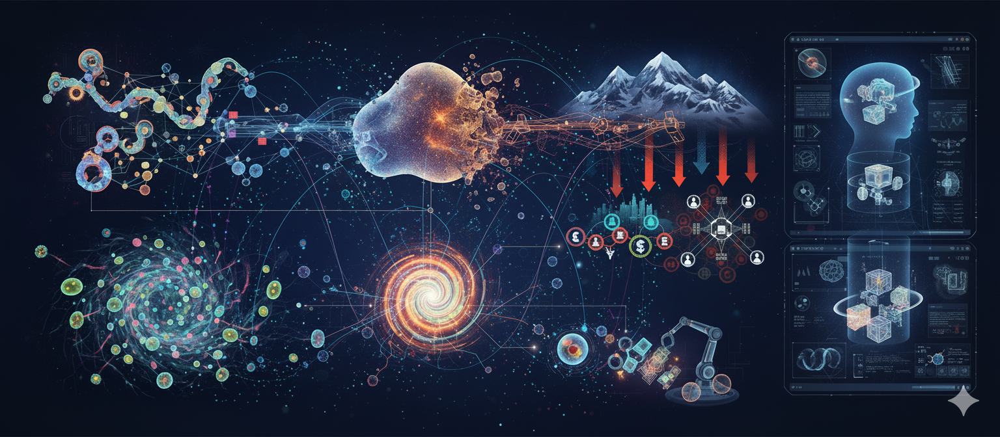
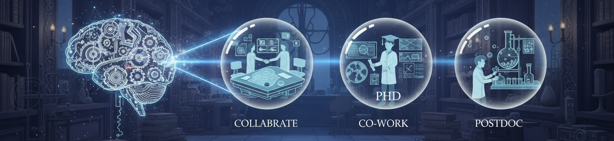
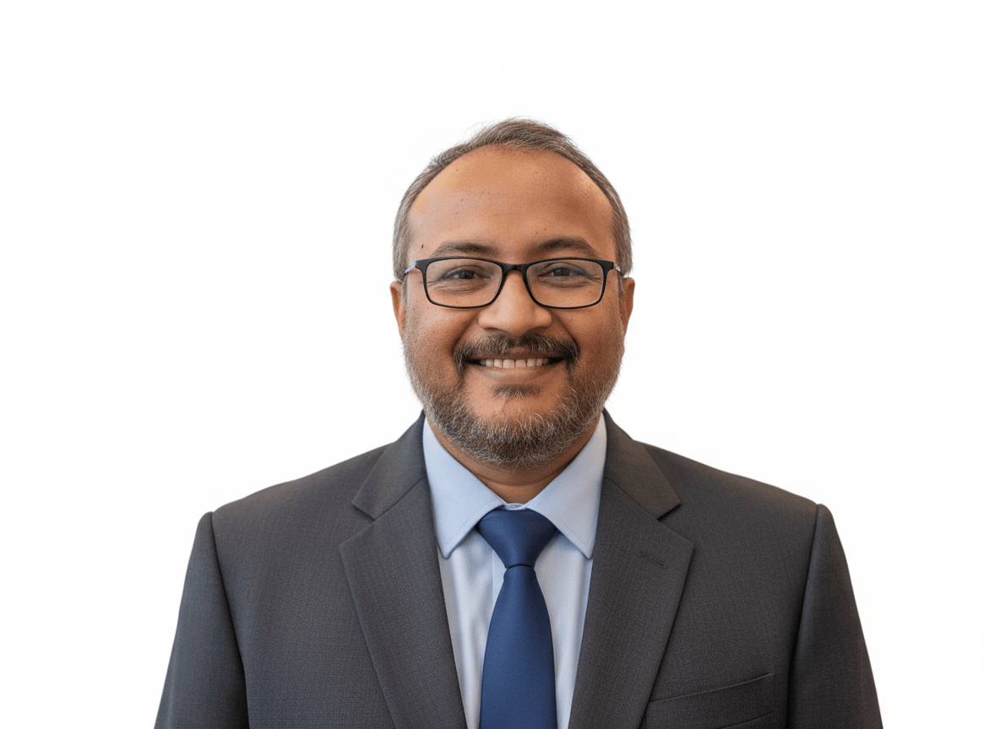

<html lang="en" data-theme="quantum">
<head>
    <meta charset="UTF-8">
    <meta name="viewport" content="width=device-width, initial-scale=1.0, maximum-scale=5.0">
    <meta name="theme-color" content="#080d18">
    <meta name="description" content="Physics + AI research, teaching, publications and lab projects.">
    <link rel="manifest" href="manifest.webmanifest">
    <link rel="apple-touch-icon" href="icons/icon-192.png">
    <title>iLab - Portfolio</title>
    <!-- Modern Typography Imports -->
    <link rel="preconnect" href="https://fonts.googleapis.com">
    <link rel="preconnect" href="https://fonts.gstatic.com" crossorigin>
    <link href="https://fonts.googleapis.com/css2?family=DM+Sans:wght@400;500;600;700&family=Space+Grotesk:wght@400;500;600;700&family=Sora:wght@400;500;600;700;800&family=IBM+Plex+Mono:wght@400;500;600&display=swap" rel="stylesheet">
    
    
</head>
<body>

    <!-- MAIN HEADER -->
    <header class="main-header">
        <!-- Top Row: Title, Main Nav Buttons, and Theme Switcher Button -->
        

            
Physics+AI

            <ul class="top-nav-links">
                <li><a href="#research" class="nav-link">Research</a></li>
                <li><a href="#publication" class="nav-link">Publication</a></li>
                <li><a href="#about" class="nav-link">About</a></li>
            </ul>

            <!-- Multi-Theme Dropdown Switcher -->
            

                <button class="theme-toggle-btn" id="theme-toggle" aria-label="Toggle Theme">
                    🌌
                    Quantum
                    ▾
                </button>
                

                    <button class="theme-opt active" data-theme-val="quantum">
                        
                        Quantum Glow
                    </button>
                    <button class="theme-opt" data-theme-val="aurora">
                        
                        Aurora Emerald
                    </button>
                    <button class="theme-opt" data-theme-val="solar">
                        
                        Solar Flare
                    </button>
                    <button class="theme-opt" data-theme-val="obsidian">
                        
                        Obsidian Monolith
                    </button>
                    <button class="theme-opt" data-theme-val="opal">
                        
                        Opal Daylight
                    </button>
                

            

            <button class="install-app-btn" id="install-app" type="button" aria-label="Install this website" title="Install this website">
                ↓Install
            </button>
        

        <!-- Bottom Row: Other Navigation Links -->
        <nav class="navbar">
            <ul class="nav-links">
                <li><a href="#highlight" class="nav-link active">Home</a></li>
                <li><a href="#teaching" class="nav-link">Teaching</a></li>
                <li><a href="#outreach" class="nav-link">Outreach</a></li>
                <li><a href="#latest" class="nav-link">Latest</a></li>
                <li><a href="#classroom" class="nav-link">Live Class Room</a></li>
                <li><a href="#products" class="nav-link">Lab Products</a></li>
                <li><a href="#misc" class="nav-link">Misc</a></li>
                <li><a href="#playground" class="nav-link">Playground</a></li>
            </ul>
        </nav>
    </header>

    

        <!-- 1. Highlight Page -->
        

            
           
            <h2>Lab 360° | The Nexus of Data-driven Creativity</h2>

Welcome to <b>Lab 360°</b>—a crucible of innovation where abstract contemplation is transmuted into purposeful action, and action into world-shaping realities. Embracing an omnidirectional perspective, we traverse the physical continuum from the quantum choreography of molecular assemblies to the subterranean fury of seismic faults, and from automated kinematic systems to predictive climate modeling. We are driven by a relentless thirst for data-fueled discovery, translating high-dimensional entropy into elegant mathematical models that power next-generation healthcare, molecular intelligence, and sustainable societal enterprise.

<ul>
    <li><b>Omnidirectional Data Exploration:</b> Dissolving conventional academic silos, our researchers synthesize insights across disparate domains—from the precision mechanics of athletic motion to continental-scale environmental rhythms—extracting harmony from complex data streams.</li>
    <li><b>Molecular Intelligence & Clinical Horizons:</b> Orchestrating deep learning with biophysical intuition, we decode the architecture of macromolecular interactions, catalyzing breakthroughs in targeted therapeutics and precision diagnostics.</li>
    <li><b>Planetary Dynamics & Structural Resilience:</b> Fusing fundamental physics with machine intelligence to anticipate catastrophic structural shifts and geodynamic hazards, fortifying communities against nature’s most extreme events.</li>
    <li><b>Deep Tech for Humanitarian Enterprise:</b> We treat discovery not merely as an intellectual pursuit, but as a moral imperative—incubating agile, socially conscious ventures that transform laboratory breakthroughs into enduring global value.</li>
</ul>

Though we are new, Lab 360° is guided by an ambitious mandate: to empower a cadre of forward-looking thinkers equipped to craft the technological paradigms of tomorrow.

<h2>Lab 360° has a heart of Physics</h2>

Positioned at the luminous crossroads of non-equilibrium physics and machine intelligence, we uncover the universal principles that govern intricate, multi-scale systems. We approach artificial intelligence not merely as an engine for empirical prediction, but as an epistemic prism—a tool to reveal the latent mathematical harmonies of the cosmos. Our central research thrusts comprise:

<ul>
    <li><b>Collective Intelligence in Natural and Synthetic Swarms:</b> How do autonomous entities—from avian murmurations and cellular monolayers to coordinated robotic swarms—manifest collective genius from minimal local rules? We investigate the physical principles of emergence to engineer resilient, self-organizing synthetic systems.</li>
    <li><b>Physics of Living Matter & Morphogenesis:</b> Viewing biological assemblies through the lens of active matter, we illuminate the biomechanical forces orchestrating tissue repair, pattern formation, and embryonic growth, charting new possibilities for regenerative bioengineering.</li>
    <li><b>Mechanics of Disordered & Amorphous Solids:</b> Defying crystalline predictability, glasses and granular media conceal subtle preludes to catastrophic failure. We develop physics-informed algorithms capable of detecting the structural precursors to rupture, pioneering the design of ultra-durable, damage-tolerant materials.</li>
    <li><b>Interpretable Machine Intelligence for Fundamental Discovery:</b> Transcending opaque black-box models, our neural architectures are sculpted to distill sparse, transparent governing equations directly from raw observation, revealing fundamental physical laws that ignite bold scientific hypotheses.</li>
</ul>

Flourishing at the vibrant intersection of theoretical elegance and experimental craftsmanship, we cultivate an intellectual commons where fearless curiosity gives rise to enduring innovation.

            

                <h3>🌟 Highlights</h3>
                <ul>
                    <li><strong>Research Interests:</strong> Investigating the dynamics of natural and artificial complex systems, with a focus on out-of-equilibrium soft, glassy, and active matter.</li>
                    <li><strong>Physics at the Interface of AI:</strong> By training models from physical systems, we integrate fundamental physical laws into novel AI models. This involves using high-performance computing and explainable AI to decode molecular information processing, predict material failure, and attempts to understand emergent behaviors in living and artificial systems.</li>
                    <li><strong>Teaching and Mentoring:</strong> Engaged in teaching courses such as Mathematics for AI and Intelligent Systems, and mentoring research interns and graduate students.</li>
                </ul>
            

            

                <h2>🌟 Join Us </h2>
                

                    <h1>Join Us to Innovate</h1>
                    
 We are seeking creative individuals to join our lab to co-create the future.

           
                    
Whether you are an established researcher, a budding scientist, or a creative force eager to collaborate, we have a place for you. We are actively seeking passionate individuals for:

           
                    

                        
Collaborative Projects

                        
Internship Opportunities

                        
PhD Positions

                        
Postdoctoral Fellowships

                    

           
                    
Find your chance to work on projects that matter, surrounded by a team to pushing the boundaries of what's possible. We believe in the power of diversity and the magic that happens when generative minds connect.

           
                    

                        <h2 style="justify-content: center; border: none;">Ready to answer the call?</h2>
                        
We want to hear from you: your vision and plans with us. Email your one-page CV, a well supported SOP

                        <a href="mailto:sumandutta.avvcb@gmail.com" class="email-link">Submit</a>
                    

           
                    
Let's build the future together.

                

                
            

        

        <!-- 2. Research Page -->
        

            <h2>🔬 Research Interests & Competencies</h2>
            

                <h3>Research Expertise</h3>
                <ul>
                    <li><strong>Domain Expertise:</strong> Collective Intelligence in Living and Artificial Systems, Physics of Complex Fluids, Soft Condensed Matter. </li>
                    <li><strong>Core Competencies:</strong> Creative Research, Out-of-Equilibrium Statistical Physics, Machine Learning Order Disorder.</li>
                </ul>
            

            

                
                
            

            

                <h3>Key Research Areas</h3>
                <ul>
                    <li class="research-area-item"><strong>Soft, Glassy, Active & Adaptable Matter</strong></li>
                    <li class="research-area-item"><strong>Physics of Flow, Glass & Living Machines</strong></li>
                    <li class="research-area-item"><strong>Material Failure and Molecular Information Processing</strong></li>
                    <li class="research-area-item"><strong>Mechanobiology, Catastrophe Science, Emergent Intelligence</strong></li>
                </ul>
            

            

                <h3>Extensive Experience in</h3>
                <ul>
                    <li>Soft Condensed Matter</li>
                    <li>High Performance Computing (Molecular Simulations)</li>
                </ul>
            

            

                <h3>Research within the Group</h3>
                
We perform extensive computer simulations, harnessing the power of High-Performance Computing (HPC), alongside statistical methods. Our aim is to develop and deploy data-driven yet inherently explainable techniques. These methods are meticulously designed to systematically investigate the intricate complex processes that drive autonomous organization and the phenomena of failure in both living and artificial systems. Our approach bridges the gap between complex data analysis and fundamental scientific understanding, ensuring our findings are not only predictive but also interpretable.

                
Our research endeavors delve into several key directions, offering a comprehensive exploration of complex systems:

                <ul>
                    <li><strong>Molecular Information Processing:</strong> We meticulously decode how molecular systems store, manipulate, and relay information. This involves unraveling the fundamental principles that govern adaptive behaviors observed in both natural biological networks and synthetic molecular constructs. By understanding these intricate mechanisms, we aim to engineer more sophisticated and responsive artificial systems.</li>
                    <li><strong>Cellular Migration and Turbulence:</strong> We investigate the often chaotic and dynamic patterns exhibited by migrating cells. This research focuses on understanding their collective dynamics during critical biological processes such as tissue formation, repair, and in cases of failure. By analyzing these complex movements, we gain insights into emergent behaviors and the underlying physical constraints.</li>
                    <li><strong>Failure and Jamming of Amorphous Systems:</strong> A significant area of our work explores the transitions of disordered materials between fluid-like and rigid states. We aim to develop predictive models that can accurately forecast their resilience, pinpoint critical points of failure, and understand the jamming phenomena that can lead to material collapse.</li>
                    <li><strong>Predicting Vulnerability and Avalanches:</strong> We develop models that capture the dynamics of critical cascades—phenomena ranging from natural avalanches to the interconnectedness of economic societies. Our goal is to forecast the likelihood and potential impact of systemic failures, thereby enabling proactive mitigation strategies.</li>
                    <li><strong>Autonomous and Critical Phenomena in Living and Artificial Systems:</strong> We are deeply interested in the emergence of self-organized behaviors in systems poised at critical thresholds. By studying these systems, we aim to uncover the delicate balance between stability and adaptability, and how these seemingly opposing forces coexist to drive complex system evolution.</li>
                    <li><strong>Generative Physical Intelligence:</strong> We are pioneering the development of novel generative models that are deeply integrated with the fundamental laws of physics. This research aims to create AI systems capable of not only predicting but also generating physically plausible dynamics and structures. By teaching models the principles of statistical mechanics and emergent phenomena, we seek to build intelligent agents that can autonomously discover new materials, understand system failures, and generate innovative solutions to a complex physical challenges.</li>
                </ul>
            

        

        <!-- Publication Page -->
        

            <h2>📚 Publications</h2>
            

                <h3>2026</h3>
                

                    
V. Vaibhav, T. Das & <u>S. Dutta</u>*, <em>Persistently Non-Gaussian Metastable Liquids</em>, Ann. Phys. (Berlin) 538 (4), e00247(2026) [<a href="https://onlinelibrary.wiley.com/doi/pdf/10.1002/andp.202500247" target="_blank" rel="noopener noreferrer">LINK</a>]

                    
<strong>Contribution:</strong> <u>Corresponding author</u>

                

                <h3>2025</h3>
                

                    
S. Santra, L. Touzo, C. Dasgupta, A. Dhar, <u>S. Dutta</u>, A. Kundu, P. Le Doussal, G. Schehr & P. Singh, <em>Crystal to liquid cross-over in the active Calogero-Moser model</em>, J. Stat. Mech. 033203 (2025) [<a href="https://iopscience.iop.org/article/10.1088/1742-5468/adbb5d" target="_blank" rel="noopener noreferrer">LINK</a>]

                    
<strong>Contribution:</strong> <u>Contributing author</u>

                

                

                    
<u>S. Dutta</u>*, P. Chaudhuri, M. Rao & C. Dasgupta, <em>Activity-driven sorting, approach to criticality and turbulent flows in dense persistent active fluids</em>, arXiv:2509.00376 (2025) [<a href="https://arxiv.org/abs/2509.00376" target="_blank" rel="noopener noreferrer">LINK</a>] 

                    
<strong>Contribution:</strong> <u>First and Corresponding author</u>

                

               
                <h3>2024</h3>
                

                    
V. Vaibhav & <u>S. Dutta</u>*, <em>Entropic timescales of Dynamic Heterogeneity in Supercooled Liquid</em>, Phys. Rev. E (Lett.), <strong>109</strong>, L062102 (2024) [<a href="https://journals.aps.org/pre/abstract/10.1103/PhysRevE.109.L062102" target="_blank" rel="noopener noreferrer">LINK</a>]

                    
<strong>Contribution:</strong> <u>Corresponding author</u>

                

                <h3>2023</h3>
                

                    
<u>S. Dutta</u>, K. Martens & P. Chaudhuri, <em>Creep response of athermal amorphous solids under imposed shear stress</em>, arXiv:2303.04718 (2023) [<a href="https://arxiv.org/abs/2303.04718" target="_blank" rel="noopener noreferrer">LINK</a>]

                    
<strong>Contribution:</strong> <u>First author</u>

                

               
                <h3>2021</h3>
                

                    
C. Liu, <u>S. Dutta</u>, P. Chaudhuri & K. Martens, <em>Elastoplastic approach based on microscopic insights for the steady state and transient dynamics of sheared disordered solids</em>, Phys. Rev. Lett., <strong>126</strong>, 138005 (2021) [<a href="https://journals.aps.org/prl/abstract/10.1103/PhysRevLett.126.138005" target="_blank" rel="noopener noreferrer">LINK</a>]

                    
<strong>Contribution:</strong> <u>Joint first author</u>

                

                <h3>2020</h3>
                

                    
R. Dandekar, S. Bose & <u>S. Dutta</u>*, <em>Non-Gaussian information of heterogeneity in soft matter</em>, Europhys. Lett., <strong>131</strong>, 18002 (2020) [<a href="https://iopscience.iop.org/article/10.1209/0295-5075/131/18002/meta" target="_blank" rel="noopener noreferrer">LINK</a>]

                    
<strong>Contribution:</strong> <u>Corresponding author</u>

                

                

                    
<u>S. Dutta</u>* & J. Chakrabarti, <em>Length-scales of dynamic heterogeneity in a driven binary colloid</em>, Phys. Chem. Chem. Phys., <strong>22</strong>, 17731 (2020) [<a href="https://pubs.rsc.org/en/content/articlelanding/2020/cp/d0cp02703k/unauth" target="_blank" rel="noopener noreferrer">LINK</a>]

                    
<strong>Contribution:</strong> <u>First and Corresponding author</u>

                

                <h3>2019</h3>
                

                    
<u>S. Dutta</u>*, <em>Microscopic insights into dynamical heterogeneity in a lane forming colloid</em>, Chem. Phys., <strong>522</strong>, 256 (2019) [<a href="https://www.sciencedirect.com/science/article/pii/S0301010418311510" target="_blank" rel="noopener noreferrer">LINK</a>]

                    
<strong>Contribution:</strong> <u>Solo author</u>

                

                <h3>2018</h3>
                

                    
<u>S. Dutta</u>* & J. Chakrabarti, <em>Transient dynamical responses of a charged binary colloid in an electric field</em>, Soft Matter, <strong>14</strong>, 4477 (2018) [<a href="https://pubs.rsc.org/en/content/articlehtml/2018/sm/c7sm02552a" target="_blank" rel="noopener noreferrer">LINK</a>]

                    
<strong>Contribution:</strong> <u>First and Corresponding author</u>

                

                <h3>2016</h3>
                

                    
<u>S. Dutta</u>* & J. Chakrabarti, <em>Anomalous dynamical responses in a driven system</em>, Europhys. Lett., <strong>116</strong>, 38001 (2016) [<a href="https://iopscience.iop.org/article/10.1209/0295-5075/116/38001/meta" target="_blank" rel="noopener noreferrer">LINK</a>]

                    
<strong>Contribution:</strong> <u>First author</u>

                

                <h3>2015</h3>
                

                    
J. Chakrabarti & <u>S. Dutta</u>, <em>Analytical form of forces in hydrophobic collapse</em>, Chem. Phys. Lett., 620, <strong>109</strong> (2015) [<a href="https://www.sciencedirect.com/science/article/pii/S0009261414010483" target="_blank" rel="noopener noreferrer">LINK</a>]

                    
<strong>Contribution:</strong> <u>Second author</u>

                

            

        

        <!-- 3. Teaching Page -->
        

            <h2>💡 Teaching & Mentoring</h2>
            

                <h3>Glimpses</h3>
                
Moments from My Classes

                

                    <iframe src="slideshow.html" frameborder="0"></iframe>
                

            

           
            <!-- TEACHING DASHBOARD -->
            

                

                    Explore our academic engagements, mentoring programs, and pedagogical philosophy.
                

                

                    <!-- Card 1: Academic Courses -->
                    

                        

                            <h4>👨‍🏫 Academic Courses</h4>
                            
<strong>Focus:</strong> AI, Mathematics & Material Science

                            
Courses delivered at Amrita Vishwa Vidyapeetham and S. N. Bose National Centre for Basic Sciences.

                            <ul style="margin-top:10px; font-size: 0.9em; color: var(--text-secondary);">
                                <li>Mathematics for Intelligent Systems-III (23MAT204)</li>
                                <li>Introduction to Material Informatics (23CHY115)</li>
                                <li>Mathematics for Intelligent Systems-I (23MAT106)</li>
                                <li>Research Methodology (PHY501)</li>
                            </ul>
                        

                        

                            View Course List &rarr;
                        

                    

                    <!-- Card 2: Mentoring -->
                    

                        

                            <h4>🤝 Mentoring & Supervision</h4>
                            
<strong>Role:</strong> Advisor & Co-Supervisor

                            
Guiding research interns, Masters thesis students, and student collaborators.

                            

                                Interns
                                Thesis
                            

                        

                        

                            View Student Profiles &rarr;
                        

                    

                    <!-- Card 3: Philosophy -->
                    

                        

                            <h4>🧠 Teaching Philosophy</h4>
                            
<strong>Approach:</strong> Interactive & Generative

                            
Believing in "Learning by Doing" and bridging the gap between theoretical Physics and applied AI.

                        

                        

                            Read Methodology &rarr;
                        

                    

                

            

            <!-- DETAILED VIEW: ACADEMIC COURSES -->
            

                <button class="back-btn" onclick="closeTeachingSection()">
                    <svg xmlns="http://www.w3.org/2000/svg" width="16" height="16" viewBox="0 0 24 24" fill="currentColor"><path d="M20 11H7.83l5.59-5.59L12 4l-8 8 8 8 1.41-1.41L7.83 13H20v-2z"/></svg>
                    Back to Dashboard
                </button>
                

                    <h3>Courses Taught</h3>
                    

                        <table>
                            <thead>
                                <tr>
                                    <th>Course Code</th>
                                    <th>Credit</th>
                                    <th>Hrs/Week</th>
                                    <th>Session</th>
                                    <th>Students</th>
                                    <th>TLP-Feedback</th>
                                </tr>
                            </thead>
                            <tbody>
                                <tr>
                                    <td>Mathematics for Intelligent System - III (B.Tech in AI & Data Science, Semester-III)</td>
                                    <td>3+3</td>
                                    <td>4+4</td>
                                    <td>2026-27 Odd</td>
                                    <td>65+66</td>
                                    <td>Ongoing</td>
                                </tr>
                                <tr>
                                    <td>Introduction to Material Informatics (B.Tech in AI & Data Science, Semester-II)</td>
                                    <td>3+3</td>
                                    <td>4+4</td>
                                    <td>2025-26 Even</td>
                                    <td>64+65</td>
                                    <td>92.92%</td>
                                </tr>
                                <tr>
                                    <td>Mathematics for Intelligent System - I (B.Tech in AI & Data Science, Semester-I)</td>
                                    <td>4+4</td>
                                    <td>5+5</td>
                                    <td>2025-26 Odd</td>
                                    <td>65+66</td>
                                    <td>93.11%</td>
                                </tr>
                            </tbody>
                        </table>
                    

                

            

            <!-- DETAILED VIEW: MENTORING -->
            

                <button class="back-btn" onclick="closeTeachingSection()">
                    <svg xmlns="http://www.w3.org/2000/svg" width="16" height="16" viewBox="0 0 24 24" fill="currentColor"><path d="M20 11H7.83l5.59-5.59L12 4l-8 8 8 8 1.41-1.41L7.83 13H20v-2z"/></svg>
                    Back to Dashboard
                </button>
                

                    <h3>Research Supervision</h3>
                    

                        <strong>Research Interns</strong>
                        
A. Jagdish, School of Physical Sciences, Amrita Vishwa Vidyapeetham (06/2025 onwards)

                    

                    

                        <strong>Student Collaborators</strong>
                        
A. Harish, Department of Mathematics, Amrita Vishwa Vidyapeetham (06/2025 onwards)

                        
A. Venkatraman, Department of Mathematics, Amrita Vishwa Vidyapeetham (06/2025 onwards)

                        
P. S. Mrudula, Department of AI, Amrita Vishwa Vidyapeetham (11/2025 onwards)

                    

                    

                        <strong>Masters Thesis Co-supervision</strong>
                        
Magnus Olsen, <em>Understanding Non-Newtonian Materials</em>   (Supervisor: R. Cabriolu, Norwegian University of Science and Technology, since 08/2025)

                    

                    

                        <strong>Supervision: Topical Projects</strong>
                        

                            <table>
                                <thead>
                                    <tr>
                                        <th>Subject Code</th>
                                        <th>Names</th>
                                        <th>Title</th>
                                    </tr>
                                </thead>
                                <tbody>
                                    <!-- 23CHY115 Projects -->
                                    <tr>
                                        <td>23CHY115</td>
                                        <td>Adithya R, Ashwin Krishna V, Madhan S, Nawin K.G</td>
                                        <td>Prediction of Molecular Solubility</td>
                                    </tr>
                                    <tr>
                                        <td>23CHY115</td>
                                        <td>Mahalakshmi R, Venugopalan G, Ram Eswar P, Selva Vignesh V</td>
                                        <td>Semantic RAG with Specialized Embeddings</td>
                                    </tr>
                                    <tr>
                                        <td>23CHY115</td>
                                        <td>A. Shashank Royal, M. Dinesh Kumar, M. Sujan, K. Aravind Guptha</td>
                                        <td>Bio-Match: Implant Material Recommender</td>
                                    </tr>
                                    <tr>
                                        <td>23CHY115</td>
                                        <td>P. Manvith, M. Venkat Naidu, S. Manoj Chowdary, B. Nakul</td>
                                        <td>Earthquake Probability & Early Warning Analysis</td>
                                    </tr>
                                    <tr>
                                        <td>23CHY115</td>
                                        <td>Rithvik, Venkat, Abhishek, Grishmanth</td>
                                        <td>Forecasting Stress-Strain with Koopman</td>
                                    </tr>
                                    <tr>
                                        <td>23CHY115</td>
                                        <td>Rithvik Arulprakash, Harshith K. V, Vijayamurughan S, Vipin Sudhakar</td>
                                        <td>AI-Driven Dynamics in Active Glass</td>
                                    </tr>
                                    <tr>
                                        <td>23CHY115</td>
                                        <td>Suthasrinitha K.G, Asmitha T, Moushika S, Mirudhunya V</td>
                                        <td>Governing Equations of Chaotic Systems</td>
                                    </tr>
                                    <tr>
                                        <td>23CHY115</td>
                                        <td>J. Harini, A. Harsha Sree, B. Pavani, P. Prasad</td>
                                        <td>Identifying Metastable States with HAVOK</td>
                                    </tr>
                                    <tr>
                                        <td>23CHY115</td>
                                        <td>B. Lalith, K. Swami, M. Pranavi, N. Manoj</td>
                                        <td>The Sandpile Model (BTW)</td>
                                    </tr>
                                    <tr>
                                        <td>23CHY115</td>
                                        <td>N.V. Varshitha, A. Jahnavi, T. Varshini, B. Sai Prasanna</td>
                                        <td>Polymer Property Prediction Simulator</td>
                                    </tr>
                                    <tr>
                                        <td>23CHY115</td>
                                        <td>V.R. Yasswant, Abishek S, Y. Sanmukha Sai, U. Sudheer</td>
                                        <td>Convex Hull for Alloy</td>
                                    </tr>
                                    <tr>
                                        <td>23CHY115</td>
                                        <td>Hari Priya, Maha Sri, Neha, Prathibaa</td>
                                        <td>SINDy - Discovering Physics from Data</td>
                                    </tr>
                                    <tr>
                                        <td>23CHY115</td>
                                        <td>Moorthy Neeraj, Mortha Sathwik, Surya Charan Teja, Pavan Kalyan S.V, Dhanush</td>
                                        <td>Lennard-Jones System for Glass Formation</td>
                                    </tr>
                                    <tr>
                                        <td>23CHY115</td>
                                        <td>Sharvesh S. P, B. gurucharan, P. A. Bhavesh Jayan, Hashwin M</td>
                                        <td>The Butterfly Paradox: Chaos in MD</td>
                                    </tr>
                                    <tr>
                                        <td>23CHY115</td>
                                        <td>T.V.S.S Phanindra Guptha, Athul V.R, Nanda Kishore, M. Vittal</td>
                                        <td>Ocean Waves Dynamics</td>
                                    </tr>
                                    <tr>
                                        <td>23CHY115</td>
                                        <td>B. Sharmitha, H. Bala Sri Siva Sai Surya Tej, V. Mouli Sri, K. Bhanu Prakash</td>
                                        <td>AI-Based Material Recommendation System</td>
                                    </tr>
                                    <tr>
                                        <td>23CHY115</td>
                                        <td>D. Durga Prasad Reddy, Mukesh Reddy, G. Yaswanth Reddy, K. Praneeth, Jasmitha</td>
                                        <td>Failure Prediction in Amorphous Solids</td>
                                    </tr>
                                    <tr>
                                        <td>23CHY115</td>
                                        <td>S. Sujitkumar, M. Hemanthkumar, H. Abinavkumaran, P.V. RithikRaj</td>
                                        <td>Molecular Phase Dynamics using Koopman DMD</td>
                                    </tr>
                                    <tr>
                                        <td>23CHY115</td>
                                        <td>Kirithik B, Sankardas K.K, V. Amruth, Vishnu Prasad P</td>
                                        <td>Discontinuous Molecular Dynamics</td>
                                    </tr>
                                    <tr>
                                        <td>23CHY115</td>
                                        <td>Adharsh K, Anu R, Sidharth M, Vethavarsini A</td>
                                        <td>Rare Event Acceleration with Koopman-GNN</td>
                                    </tr>
                                    <tr>
                                        <td>23CHY115</td>
                                        <td>Akshara Sree R, Anirudh S Nair, Iniyaa Muthuselvan, Shashank Kannan</td>
                                        <td>The Battery Oracle</td>
                                    </tr>
                                    <tr>
                                        <td>23CHY115</td>
                                        <td>Harish Kumaar S, S. Sri Raghav Vatsan, Dhruv Jayesh, Prithve KC</td>
                                        <td>Predicting Swarm Dynamics</td>
                                    </tr>
                                    <tr>
                                        <td>23CHY115</td>
                                        <td>Kanish Visyanth C, Kavipranidan J.T, Navaneet K.V, Nethaaji S</td>
                                        <td>Radiation Damage Prediction</td>
                                    </tr>
                                    <tr>
                                        <td>23CHY115</td>
                                        <td>Revanth S, G Kamalesh, Jaswanth S, Elango Megabala G</td>
                                        <td>Graph Neural Networks for Molecules</td>
                                    </tr>
                                    <tr>
                                        <td>23CHY115</td>
                                        <td>K. Gayathri, P. Sri Harshini, M. Deekshitha, A. Gnana Amrutha</td>
                                        <td>AI-Based Inverse Material Selector</td>
                                    </tr>
                                    <tr>
                                        <td>23CHY115</td>
                                        <td>Rohith Meka, Kode Karrthik, Naram Divya Akhil, T. Yashwant</td>
                                        <td>Microstructure Evolution Prediction</td>
                                    </tr>
                                    <tr>
                                        <td>23CHY115</td>
                                        <td>Meenakshi Bijoy, Neelanjana J Anil, Aryananda M, Ghadige Rithika</td>
                                        <td>Learning Swarm Behaviour</td>
                                    </tr>
                                    <tr>
                                        <td>23CHY115</td>
                                        <td>U. Raghu Nandan, S. Akshaya, Nikitha, Likhit K</td>
                                        <td>De-noising MD Data via Hankel SVD</td>
                                    </tr>
                                    <tr>
                                        <td>23CHY115</td>
                                        <td>M. Harsha, M. Anudeep Reddy, P. Nihal Reddy, P. Naren</td>
                                        <td>Bayesian Optimization for Alloy Design</td>
                                    </tr>
                                    <tr>
                                        <td>23CHY115</td>
                                        <td>C. Sai Hardhik Reddy, R. Gagan Chowdhury, K. Charan Saatvikh Reddy, T. Sri Sai</td>
                                        <td>Deformation in Copper Crystals</td>
                                    </tr>
                                    <tr>
                                        <td>23CHY115</td>
                                        <td>Srikar, Sumanth, Sai Sushanth, Sai Sathwik</td>
                                        <td>Perovskite Solar Cells</td>
                                    </tr>
                                    <tr>
                                        <td>23CHY115</td>
                                        <td>Neha Saravanan, Y. Pranavi Reddy, T. Sai Varshitha</td>
                                        <td>Predicting Particle Mobility in Active Matter</td>
                                    </tr>

                                    <!-- 23MAT106 Projects -->
                                    <tr>
                                        <td>23MAT106</td>
                                        <td>Adithya R, Sai Prasanna B, Anudeep Reddy</td>
                                        <td>Stochastic Gradient Descent-Image Brightness Optimizer</td>
                                    </tr>
                                    <tr>
                                        <td>23MAT106</td>
                                        <td>Abisheik S, Ashwin Krishna V, Nakul Sharvan B, Nawin K.G</td>
                                        <td>Interior Point Method for Optimization</td>
                                    </tr>
                                    <tr>
                                        <td>23MAT106</td>
                                        <td>Raghuraman V, Vipin Sudhakar, Harshith KV, Rithvik Arul Prakash</td>
                                        <td>Optimization Using Sequential Quadratic Programming</td>
                                    </tr>
                                    <tr>
                                        <td>23MAT106</td>
                                        <td>Harish Kumaar S, Prabakar, Venkat D, Prithve K C</td>
                                        <td>Minimizing 2-D Lennard-Jones System via Broyden’s Good Method</td>
                                    </tr>
                                    <tr>
                                        <td>23MAT106</td>
                                        <td>V R Yasswant, S. Sri Raghav Vatsan, Selva Vignesh V, Madhan S</td>
                                        <td>Augmented Lagrangian Method for Constrained Optimization</td>
                                    </tr>
                                    <tr>
                                        <td>23MAT106</td>
                                        <td>P. Manvith Sharma, P. Grishmanth, P. Naren, S. Manoj</td>
                                        <td>Broyden’s Bad Method for Energy Minimization</td>
                                    </tr>
                                    <tr>
                                        <td>23MAT106</td>
                                        <td>P. Sri Harshini, K. Gayathri, M. Deekshitha, Meenakshi Bijoy</td>
                                        <td>Movie Recommendation System</td>
                                    </tr>
                                    <tr>
                                        <td>23MAT106</td>
                                        <td>S Jaswant, Revanth S, Elango Megabala G, G Kamalesh</td>
                                        <td>Steepest Descent Algorithm</td>
                                    </tr>
                                    <tr>
                                        <td>23MAT106</td>
                                        <td>Rohith Meka, Naram Divya Akhil, B. Sai Srikar, Danush Mani Yerramsetti</td>
                                        <td>Movie Recommendation Using SVD</td>
                                    </tr>
                                    <tr>
                                        <td>23MAT106</td>
                                        <td>P.S. Sathwik, V.S. Amruth Chowdary, Kirithik B, Sankar Das K.K</td>
                                        <td>Computational Search for Glassy States using Conjugate Gradient</td>
                                    </tr>
                                    <tr>
                                        <td>23MAT106</td>
                                        <td>SV Pavan Kalyan, Neeraj M, C. Jasmitha, S. Akshaya, G. Rithika</td>
                                        <td>Audio Compression using SVD</td>
                                    </tr>
                                    <tr>
                                        <td>23MAT106</td>
                                        <td>B. Sharmitha, H. Bala Sri Siva Sai Surya Tej, V. Mouli Sri, K. Bhanu Prakash</td>
                                        <td>Energy Minimization of 2D Particle System via L-BFGS</td>
                                    </tr>
                                    <tr>
                                        <td>23MAT106</td>
                                        <td>Mortha Sathwik, Surya Charan Tej B, AryaNanda M, Neelanjana J Anil</td>
                                        <td>Computer Glassy States via Newton-Raphson Method</td>
                                    </tr>
                                    <tr>
                                        <td>23MAT106</td>
                                        <td>T.V.S.S Phanindra Guptha, M. Vittal, K. Nanda Kishore, Athul V.R</td>
                                        <td>Lennard-Jones Potential via Nelder-Mead</td>
                                    </tr>
                                    <tr>
                                        <td>23MAT106</td>
                                        <td>Y. Pranavi Reddy, Neha Saravanan, T. Sai Varshitha Reddy, K.B Nikitha Krishna</td>
                                        <td>Optimization of Lennard-Jones via PSO</td>
                                    </tr>
                                    <tr>
                                        <td>23MAT106</td>
                                        <td>Nethaaji S, Navaneet KV, Kavipranidan JT, Kanish Visyanth C</td>
                                        <td>Computer Glassy States through Simulated Annealing</td>
                                    </tr>
                                    <tr>
                                        <td>23MAT106</td>
                                        <td>Prasad Reddy, Sai Praneeth, Mukesh Reddy, Yaswanth Reddy</td>
                                        <td>Adopted Basis Newton-Raphson Method</td>
                                    </tr>
                                    <tr>
                                        <td>23MAT106</td>
                                        <td>Kode Karrthik, Kella Likhith, T. Yaswanth Sai Vedadri, U. Raghu Nandan</td>
                                        <td>Glassy States by Instantaneous Quench (FIRE Algorithm)</td>
                                    </tr>
                                    <tr>
                                        <td>23MAT106</td>
                                        <td>H. Abinavkumaran, S. Sujitkumar, M. Hemanthkumar, P.V. RithikRaj</td>
                                        <td>Stable Particle Arrangement via Barzilai-Borwein Method</td>
                                    </tr>
                                    <tr>
                                        <td>23MAT106</td>
                                        <td>Vishnu Prasad, N Sai Sushanth Reddy, Hari Sumanth, Gnana Amrutha</td>
                                        <td>Glassy States via Instant Quenching</td>
                                    </tr>
                                    <tr>
                                        <td>23MAT106</td>
                                        <td>B. Lalith Hari Sainath Reddy, N. Manoj Kumar, P. Krishna Prasad, K. Swamy</td>
                                        <td>Powell’s Method for Energy Minimization</td>
                                    </tr>
                                    <tr>
                                        <td>23MAT106</td>
                                        <td>Moushika S, Iniyaa Muthuselvan, Alamuru Harsha Sree, Akshara Sree R</td>
                                        <td>Levenberg-Marquardt Algorithm for Glass Optimization</td>
                                    </tr>
                                    <tr>
                                        <td>23MAT106</td>
                                        <td>Suthasrinitha K G, Mirudhunya V, Asmitha T, Ram Eswar P</td>
                                        <td>RMS Propagation Optimization</td>
                                    </tr>
                                    <tr>
                                        <td>23MAT106</td>
                                        <td>Pavani B, Maha Sri N, Neha S, Varshini T</td>
                                        <td>Basin Hopping Algorithm</td>
                                    </tr>
                                    <tr>
                                        <td>23MAT106</td>
                                        <td>Ala Shashank Royal, M. Dinesh Kumar, M. Sujan, K. Aravind Guptha</td>
                                        <td>Smart Diet Planner</td>
                                    </tr>
                                    <tr>
                                        <td>23MAT106</td>
                                        <td>B. Lalith, N. Manoj Kumar, P. Krishna Prasad, K. Swamy</td>
                                        <td>Powell’s Method of Optimization</td>
                                    </tr>
                                    <tr>
                                        <td>23MAT106</td>
                                        <td>K. Charan Saatvikh Reddy, R. Gagan Chowdary, C. Sai Hardhik Reddy, M. Venkat Naidu</td>
                                        <td>Adagrad Optimization</td>
                                    </tr>
                                    <tr>
                                        <td>23MAT106</td>
                                        <td>Dhruv Jayesh Kansagara, Nihal Reddy P, T. Sri Sai, Y. Sanmukha Sai</td>
                                        <td>BFGS with Trust Region</td>
                                    </tr>
                                    <tr>
                                        <td>23MAT106</td>
                                        <td>J. Harini, Prathibaa, Mahalakshmi</td>
                                        <td>Image Compression using SVD</td>
                                    </tr>
                                    <tr>
                                        <td>23MAT106</td>
                                        <td>Aadharsh, Anu R, Sidharth M, Vethavarsini A</td>
                                        <td>Glassy States via Instantaneous Quench (TNM)</td>
                                    </tr>
                                    <tr>
                                        <td>23MAT106</td>
                                        <td>M. Dinesh Kumar, M. Sujan, K. Aravind Guptha, A. Sheshank Royal</td>
                                        <td>Smart Diet Planner (Revised)</td>
                                    </tr>
                                    <tr>
                                        <td>23MAT106</td>
                                        <td>Madhan Senthil Kumar, Selva Vignesh V, S. Sri Raghav Vatsan, V.R. Yasswant</td>
                                        <td>Augmented Lagrangian Method (ALM)</td>
                                    </tr>
                                    <tr>
                                        <td>23MAT106</td>
                                        <td>B. Sai Prasanna Anjaneyulu, M. Annudeep Reddy, R. Adithya</td>
                                        <td>Image Enhancement Using SGD</td>
                                    </tr>
                                    <tr>
                                        <td>23MAT106</td>
                                        <td>Mukesh Reddy, D. Durga Prasad Reddy, Yaswanth Reddy, K. Sai Praneeth</td>
                                        <td>Lennard-Jones via Adopted Basis Newton-Raphson</td>
                                    </tr>
                                    <tr>
                                        <td>23MAT106</td>
                                        <td>Anirudh S Nair, Shashank Kannan, Vijayamurughan S, G. Venugopalan</td>
                                        <td>The Math Behind PageRank</td>
                                    </tr>
                                </tbody>
                            </table>
                        

                    

                

            

            <!-- DETAILED VIEW: PHILOSOPHY -->
            

                <button class="back-btn" onclick="closeTeachingSection()">
                    <svg xmlns="http://www.w3.org/2000/svg" width="16" height="16" viewBox="0 0 24 24" fill="currentColor"><path d="M20 11H7.83l5.59-5.59L12 4l-8 8 8 8 1.41-1.41L7.83 13H20v-2z"/></svg>
                    Back to Dashboard
                </button>
                

                    <h3>My Teaching Philosophy</h3>
                    
My approach to teaching is grounded in the belief that the interface between Physics and Artificial Intelligence provides a unique playground for intuitive understanding. I emphasize:

                    <ul>
                        <li><strong>Active Learning:</strong> Moving beyond lectures to include live coding sessions, simulation workshops, and "playground" style problem solving.</li>
                        <li><strong>Interdisciplinary Thinking:</strong> Encouraging students to see the mathematical structures common to both quantum mechanics and machine learning.</li>
                        <li><strong>Project-Based Assessment:</strong> Evaluating understanding through the creation of tangible models and tools (like our Lab Products) rather than just rote memorization.</li>
                    </ul>
                    
<em>"Education is not the learning of facts, but the training of the mind to think." - Albert Einstein</em>

                

            

        

        <!-- 4. About Me Page -->
        

            <h2>Group Leader</h2>
            

                
                

                    <h1>Suman Dutta</h1>
                    
Researcher | Intelligent Living & Artificial Systems

                

            

            <h2> About Me</h2>
            
I am a <strong>Creative</strong> researcher in the field of <strong>Intelligent Complex Systems</strong>, with a specialization in <strong>out-of-equilibrium Complex Fluids</strong>. I investigate model dynamics of <strong>Natural and Artificial Systems</strong>, combining <strong>Statistical Physics</strong>, <strong>High Performance Computing </strong> and <strong>Machine Intelligence</strong>, with an aim to develop strategies for <strong>Generative Physical Systems</strong>.

            

                <h3>🎓 Professional Journey</h3>
                <h4>Present Affiliation</h4>
                
<strong>Gemini Certified Faculty</strong> (2026-2028) 

                
<strong>Assistant Professor (Sr. Gr.), Department of Artificial Intelligence</strong> School of AI, Amrita Vishwa Vidyapeetham, Coimbatore HQ 

                <h4>Professional Research Experience</h4>
                <ul>
                    <li><strong>Post Doctoral Fellow</strong> (01/2024 – 09/2024) Simons Centre for the Study of Living Machines, National Centre for Biological Sciences - Tata Institute of Fundamental Research, Bangalore (Advisor: M. Rao)</li>
                    <li><strong>Post Doctoral Fellow</strong> (01/2021 – 12/2023) International Centre for Theoretical Sciences - Tata Institute of Fundamental Research, Bangalore (Advisor: C. Dasgupta)</li>
                    <li><strong>Post Doctoral Fellow</strong> (02/2018 – 12/2020) The Institute of Mathematical Sciences, Chennai (Advisor: P. Chaudhuri, in collaboration with K. Martens)</li>
                </ul>
                <h4>Visiting Researcher Experience</h4>
                <ul>
                    <li>Fluvial Mechanics Laboratory Indian Statistical Institute (Kolkata, IN) </li>
                    <li>Department of Physics Indian Institute of Science (Bangalore, IN) </li>
                    <li>Department of Physics Indian Institute of Science Education and Research (Bhopal, IN) </li>
                    <li>Laboratoire Interdisciplinaire de Physique Université Grenoble Alpes (Grenoble, FR) </li>
                    <li>Institut für Theoretische Physik II - Soft Matter Heinrich-Heine-Universität (Düsseldorf, DE) </li>
                </ul>
                <h4>Education</h4>
                <ul>
                    <li><strong>Ph.D in Physics</strong> (08/2012 – 01/2018) Department of Chemical, Biological and Macromolecular Sciences, S. N. Bose National Centre for Basic Sciences, Kolkata (Degree awarded by University of Calcutta)  <em>Thesis:</em> Numerical Studies on the Dynamics of Soft Matter Systems (Advisor: J. Chakrabarti)</li>
                    <li><strong>M.Sc in Physical Sciences</strong> (08/2010 – 07/2012) S. N. Bose National Centre for Basic Sciences (Degree awarded by West Bengal University of Technology, Kolkata)</li>
                </ul>
            

            <h2>📫 Connect</h2>
            

                

                    
                    
                    
                    
                

            

        

        <!-- NEW OUTREACH PAGE -->
        

            <h2>📢 Outreach & Community</h2>
            
Engaging with the scientific community and the public to demystify Physics and AI.

           
            

                <!-- Outreach Item 1 -->
                

                    🗣️
                    <h4>Talks</h4>
                    
Talks/Presentations

                    <ul style="font-size: 0.9em;">
                        <li>International: 3+ </li>
                        <li>National: 10+ </li>
                        <li>Total: 26+ </li>
                    </ul>
                

            
                <!-- Outreach Item 3 -->
                

                    🌍
                    <h4>Science Popularization</h4>
                    
October 31, 2025 -- Story writing by human-machine collaboration. Participation: 115 Students 

                    
February 6, 2026 -- International Mini-Workshop -- 125 Minutes (Online). Participation: 106 

                

               
                <!-- Outreach Item 4 -->
                

                    🏆
                    <h4>Competitions</h4>
                    
August 28–29, 2025-- The Class Hackathon on the theme "AI for Greener Future". Participation: 23 Groups (Each consisting of 6 Members) 

                    
March 20, 2026-- Class hackathon -II. Participation: 9 Groups (Each consisting of 4-6 Members) 

                

            

           
            

                <h3>Milestones</h3>
                

                    <strong>Human+AI Collaboration</strong>
                    
In a fusion of logic and creativity, we conducted an experimental initiative in the Autumn of 2025, challenging first-year BTech(AID) students to move beyond the mechanics of AI to the artistry of generation. The resulting anthology compiles 115 distinct narratives, representing a massive coordination of human imagination amplified by Large Language Models. This collection showcases a remarkable spectrum of themes, refracting a single premise into genres ranging from the futuristic sci-fi of The Neural Vault and ZeroTrace to the philosophical introspection of synthetic intelligence. Demonstrating how artificial tools can yield storytelling, we present the book: "Tales from the Hidden Layers — An Anthology of Neural Symphonies" (115 Stories from 115 Student coauthors from BTech AID S1 batch, 748 Pages).

                

            

        

        <!-- Latest News Page -->
        

            <h2>✨ Latest News</h2>
            

                
,

                

                        

                            <strong> Suman presented work titled "Inverse Learning Complex Systems" - by Moushika S, Ashmitha T, V Vaibhav & Suman Dutta, at the Statistical Mechanics Meeting - Kolkata coorganised by IISER-Kolkata, S. N. Bose National Centre for Basic Sciences, Bose Institute & Indian Association for the Cultivation of Science (Oct 13-15, 2026). </strong>
                        

                    

                

                        

                            <strong> Suman presented work titled "An Adaptive AI Assisted Framework for Personalized Indian Nutrition" - by M. Dinesh Kumar, M. Sujan, K. Aravind Guptha, A. Sheshank Royal, B. Surya. Tej, M. Neeraj
Dr Chakravarthy S Maddipati, Dr Br Nivedita Pavithran & Suman Dutta, at the 58th Conference of Nutrition Society of India, at Avinashilingam Institute for Home Science and Higher Education for Women (Oct 8-9, 2026). </strong>
                        

                    

                

                        

                            <strong> Poster on AI-driven Material Discovery platform - GenMatX by Revanth S, G Kamalesh, P S Sugatha, Sudip K Batabyal & Suman Dutta, at the National Conference on Quality and Safety of Biosimilars, organized by IPC & C-CAMP (Sept 10-11, 2026). </strong>
                        

                    

                

                        

                            <strong> Magnus Olsen submitted his Master's thesis titled 'Molecular dynamics simulations of
non-Newtonian flow in glassy materials' at Department of Physics, Faculty of Natural Sciences, Norwegian University of Science and Technology (Supervisor: R. Cabriolu, Co-supervisor: Suman Dutta) (Sept 07, 2026) </strong>
                        

                    

                    

                        

                            <strong> Siddharth M and MVS Praneeth has successfully completed the summer internship at the Department of Physics, SRM University. </strong>
                        

                    

                    

                        

                            <strong> Suman delivered a talk at the Department of Physics of Complex Systems, S. N. Bose National Centre for Basic Sciences, Kolkata: Persistently Non-Gaussian Metastable Fluids </strong>
                        

                    

                    

                        

                            <strong> Moushika S selected for ICTS-TIFR Summer Course: Dynamical Systems in Neuroscience </strong>
                        

                    

                    

                        

                            <strong> Archit Harish joined the Institute of Mathematical Sciences, Chennai </strong>
                        

                    

                    

                        

                            <strong> Completed Project: Development of a Proof-of-Concept Multimodal Agentic AI System for Advanced Geological Well Log Analysis (PI: Abhijith A, Project in partnership with Telesto Energy Pvt. Ltd. via The Directorate of Corporate & Industry Relations, Amrita Vishwa Vidyapeetham, Coimbatore (2025-2026) (PI: Abhijit A., CoPI: Sai N Sundarakrishna, T. Subeesh and S. Dutta </strong>
                        

                    

                    
                    

                        

                            <strong>Publication: Persistently Non Gaussian Metastable Liquids, V. Vaibhav, T. Das and S. Dutta, Ann. Phys. (Berlin), 538 (4), e00247 (2026) </strong>
                        

                    

                    

                        

                            <strong>Oral presentation in International Mini-Workshop - 125 Minutes: Optimal Diet Plannar, M. Dinesh Kumar, M. Sujan, K. Aravind Guptha and A. Sheshank Royal </strong>
                        

                    

                    

                        

                            <strong>International Mini-Workshop - 125 Minutes was organised at School of AI (Coordinators: Dr Milton Mondal, Ayan Banerjee and Suman Dutta). </strong>
                        

                    

                    

                        

                            <strong> Suman delivered a talk at the Institute of Mathematical Sciences, Chennai: Persistently Non-Gaussian Metastable Fluids </strong>
                        

                    

            
                    

                        

                            <strong>EuroHPC Benchmark Access awarded for LUMI clusters (9th Fastest Supercomputer Globally) (PI: Raffaela Cabriolu, CoPI: Suman Dutta)</strong>
                        

                    

                    
                    

                        

                            <strong>Archit Harish selected for the Biophysical Society/ICTS-TIFR flagship Meeting: Spatial Organizations of Biophysical Functions. He presented a poster -- Learning Micro-flocking Dynamics in Living Machines by Hybrid Machine Intelligence</strong>
                        

                    

                    

                        

                            <strong>Agnevesh Jagdish selected in the ICTS-TIFR/Google flagship school: Data Science: Probabilistic and Optimization Methods II.</strong>
                        

                    

                    

                        

                            <strong>Oral presentation by Archit in International Conference: Machine Learning Material Heterogeneity at Micro-scale, A Harish, A Jagdish, A Venkatraman, S Dutta, International Conference on Advanced Materials and Green Technologies, MPD34; 74 (2025)</strong>
                        

                    

                    

                        

                            <strong>Suman Dutta joined the School of AI, Amrita Vishwa Vidyapeetham, as Assistant Professor (24 March, 2025).</strong>
                        

                    

                

            

        

        
        <!-- NEW: Live Class Room Page -->
        

             <h2>🧑‍🏫 Live Class Room</h2>
             
             <!-- Password Prompt Container -->
             

                 <h3>🔒 Access Restricted</h3>
                 
Please enter the passcode to view course materials.

                 <form id="password-form" class="password-form">
                     <input type="password" id="passcode-input" placeholder="Enter passcode" required>
                     <button type="submit">Unlock</button>
                 </form>
                 

             

             
             <!-- Protected Content -->
             

               
                <!-- DASHBOARD VIEW -->
                

                    
Welcome to the Live Class Room. Select a course below to view details.

                    

                        <!-- Card 1: 23MAT106 -->
                        

                            

                                <h4>Mathematics for Intelligent Systems - I</h4>
                                
23MAT106 Fall 2025

                                
<strong>Subject:</strong> Linear Algebra, ODEs, Probability, Quantum Computing

                                
<strong>Credit:</strong> 4 

                                
<strong>Timeline:</strong> 6 Aug - 5 Dec, 2025 

                                
<strong>Students:</strong> BTech AID, Batch A and B (Total: 133 Students) First Year, First Semester 

                            

                            

                                Click to view Schedule, Syllabus & Notes &rarr;
                            

                        

                        <!-- Card 2: 23CHY115 -->
                        

                            

                                <h4>Introduction to Material Informatics</h4>
                                
23CHY115 Spring 2026

                                
<strong>Subject:</strong> AI in Material Science

                                
<strong>Credit:</strong> 3 

                                
<strong>Timeline:</strong> 5 Jan - 4 May, 2026 

                                
<strong>Students:</strong> BTech AID, Batch A and B (Total: 129 Students) First Year, Second Semester

                            

                            

                                Click to view Schedule, Syllabus & Notes &rarr;
                            

                        

                        <!-- Card 3: 23MAT204 -->
                        

                            

                                <h4>Mathematics for Intelligent Systems - III</h4>
                                
23MAT204 Fall 2026

                                
<strong>Subject:</strong> Advanced Optimization, Multivariate Calculus, Vector Spaces

                                
<strong>Credit:</strong> 3 

                                
<strong>Timeline:</strong> 5 Aug - 4 Dec, 2026 

                                
<strong>Students:</strong> BTech AID, Batch A and B (Total: 131 Students) Second Year, Third Semester

                            

                            

                                Click to view Schedule, Syllabus & Notes &rarr;
                            

                        

                        <!-- Card: 25AID434 -->
                        

                            

                                <h4>Linear Algebra and Quantum Gates</h4>
                                
25AID434

                                
<strong>Subject:</strong> Linear Algebra and Quantum Gates

                            

                        

                        <!-- Card 4: 23MAT304 -->
                        

                            

                                <h4>Mathematics for Intelligent Systems - IV</h4>
                                
23MAT304 Spring 2027

                                
<strong>Subject:</strong> Random Processes, Advanced Probability, Statistical Inference

                                
<strong>Credit:</strong> 3 

                                
<strong>Timeline:</strong> 6 Jan - 5 May, 2027 

                                
<strong>Students:</strong> BTech AID, Batch A and B (Total: 130 Students) Second Year, Fourth Semester

                            

                            

                                Click to view Schedule, Syllabus & Notes &rarr;
                            

                        

                    

                

                <!-- DETAILED VIEW: 23MAT106 -->
                

                    <button class="back-btn" onclick="closeCourse()">
                        <svg xmlns="http://www.w3.org/2000/svg" width="16" height="16" viewBox="0 0 24 24" fill="currentColor"><path d="M20 11H7.83l5.59-5.59L12 4l-8 8 8 8 1.41-1.41L7.83 13H20v-2z"/></svg>
                        Back to Dashboard
                    </button>
                   
                    

                        <h3>Course Details</h3>
                        <ul>
                            <li><strong>Class:</strong> BTech AID</li>
                            <li><strong>Semester:</strong> Fall, 2025 </li>
                            <li><strong>Course Code:</strong> 23MAT106</li>
                        </ul>
                    

                    

                        <h3>Combined Weekly Schedule</h3>
                        
BTech (AID)

                        
Mathematics for Intelligent Systems - I - 23MAT106, School of AI, Amrita Vishwa Vidyapeetham

                        

                            <table style="text-align: center;">
                                <thead>
                                    <tr>
                                        <th>Time Slot</th>
                                        <th>Monday</th>
                                        <th>Tuesday</th>
                                        <th>Wednesday</th>
                                        <th>Thursday</th>
                                        <th>Friday</th>
                                    </tr>
                                </thead>
                                <tbody>
                                    <tr>
                                        <td style="font-weight: bold;">08:00 - 08:50</td>
                                        <td></td><td></td><td></td><td></td><td></td>
                                    </tr>
                                    <tr>
                                        <td style="font-weight: bold;">08:50 - 09:40</td>
                                        <td>Section A</td>
                                        <td></td><td></td><td></td><td></td>
                                    </tr>
                                    <tr>
                                        <td style="font-weight: bold;">09:40 - 10:30</td>
                                        <td></td><td></td>
                                        <td>Section B</td>
                                        <td></td>
                                        <td>Section A</td>
                                    </tr>
                                    <tr>
                                        <td style="font-weight: bold;">10:30 - 10:45</td>
                                        <td colspan="5" style="background: rgba(255,255,255,0.05); font-style: italic;">Break</td>
                                    </tr>
                                    <tr>
                                        <td style="font-weight: bold;">10:45 - 11:35</td>
                                        <td></td><td></td><td></td><td></td><td></td>
                                    </tr>
                                    <tr>
                                        <td style="font-weight: bold;">11:35 - 12:25</td>
                                        <td></td><td></td><td></td><td></td>
                                        <td>Section B</td>
                                    </tr>
                                    <tr>
                                        <td style="font-weight: bold;">12:25 - 01:15</td>
                                        <td></td><td></td><td></td><td></td><td></td>
                                    </tr>
                                    <tr>
                                        <td style="font-weight: bold;">01:15 - 02:05</td>
                                        <td colspan="5" style="background: rgba(255,255,255,0.05); font-style: italic;">Lunch Break</td>
                                    </tr>
                                    <tr>
                                        <td style="font-weight: bold;">02:05 - 02:55</td>
                                        <td>Section B</td>
                                        <td></td><td></td><td></td><td></td>
                                    </tr>
                                    <tr>
                                        <td style="font-weight: bold;">02:55 - 03:45</td>
                                        <td>Section B</td>
                                        <td>Section A</td>
                                        <td></td><td></td><td></td>
                                    </tr>
                                    <tr>
                                        <td style="font-weight: bold;">03:45 - 04:35</td>
                                        <td></td>
                                        <td>Section A</td>
                                        <td></td><td></td><td></td>
                                    </tr>
                                    <tr>
                                        <td style="font-weight: bold;">04:35 - 06:15</td>
                                        <td></td><td></td><td></td><td></td><td></td>
                                    </tr>
                                </tbody>
                            </table>
                        

                    

                   
                    

                        <h3>Syllabus</h3>
                        <dl>
                            <dt><strong>Unit 1</strong></dt>
                            <dd>Basics of Linear Algebra - Linear Dependence and independence of vectors - Gaussian Elimination - Rank of set of vectors forming a matrix - Vector space and Basis set for a Vector space – Dot product and Orthogonality - CR decomposition - Rotation matrices - Eigenvalues and Eigenvectors and its interpretation - Introduction to SVD. Computational experiments using Matlab/Excel/Simulink.</dd>
                           
                            <dt><strong>Unit 2</strong></dt>
                            <dd>Ordinary Linear differential equations, formulation - concept of slope, velocity and acceleration - analytical and numerical solutions - Impulse Response computations - converting higher order into first order equations - examples of ODE modelling in falling objects, satellite and planetary motion, Electrical and mechanical systems – Introduction to solving simple differential equations with Simulink - Introduction to one variable optimization - Taylor series. Computational experiments using Matlab /Excel/Simulink.</dd>

                            <dt><strong>Unit 3</strong></dt>
                            <dd>Introduction to random variables (continuous and discrete), mean, standard deviation, variance, sum of independent random variable, convolution, sum of convolution integral, probability distributions.</dd>

                            <dt><strong>Unit 4</strong></dt>
                            <dd>Introduction to quantum computing, Quantum Computing Roadmap, Quantum Mission in India, A Brief Introduction to Applications of Quantum computers, Quantum Computing Basics, Bracket Notation, Inner product, outer product, concept of state.</dd>
                        </dl>
                    

                    

                        <h3>Lecture Notes</h3>
                        <ul>
                            <li><a href="https://drive.google.com/file/d/1iQD5Idz2AqHFS5tHxHp9FYU0DpuDQ2t2/view?usp=sharing">Lecture 01: Introduction to Linear Algebra for AI (06/08/2025)</a> - (LH 310/314)</li>
                            <li><a href="https://drive.google.com/file/d/1QxHKnfaHpDvrX1Q6f9Q9I8hQ8eetbBaU/view?usp=sharing">Lecture 02: Pseudoinverse in Action: Left and Right Inverses (08/08/2025)</a> - (LH 310/314)</li>
                            <li><a href="https://drive.google.com/file/d/1tWhlRsK2VE4cyas4OhLAwnjNwyOfuxR/view?usp=sharing">Lecture 03: Pseudoinverse : Guide to your first AI application (11/08/2025)</a> - (LH 310/314)</li>
                            <li><a href="https://drive.google.com/file/d/1xMa106_qIavA7vq0Un-bNcqrSbn4ItBr/view?usp=sharing">Lecture 04: Complex Data Processing (13/08/2025)</a> - (LH 310/314)</li>
                            <li><a href="https://drive.google.com/file/d/1Cex5xgXujKA76VS8t02WuPzfFm4i7vMf/view?usp=sharing">Lecture 05-06: Introduction to Advanced Optimization and Physics-Informed Approaches(18/8/2025)</a> - (LH 310/314)</li>
                            <li><a href="https://drive.google.com/file/d/1rwP78U60kntlpxxYTe5jD12t332jRt1s/view?usp=sharing">Lecture 07: The Linear Algebra Behind Large Language Models and Generative AI (21/08/2025)</a> - (LH 310/314)</li>
                            <li><a href="https://drive.google.com/file/d/1MkGZUF9IKAIYxBv7noBz9B3FnrgaPJc5/view?usp=sharing">Lecture 08-10: The Physics behind the Data: Unveiling the Symmetries and Principal Axes of Transformations (1-5/09/2025)</a> - (LH 310/314)</li>
                            <li><a href="https://drive.google.com/file/d/1MkGZUF9IKAIYxBv7noBz9B3FnrgaPJc5/view?usp=sharing">Lecture 11-12: Introduction to Ordinary Differential Equations (8-10/9/2025)</a> - (LH 310/314)</li>
                            <li><a href="https://drive.google.com/file/d/1_PaitQ1drWka5PChDg8cy8fRMGuFMhA2/view?usp=sharing">Lecture 13-15:Impulse Response and Convolution(10-13/09/2025)</a> - (LH 310/314)</li>
                            <li><a href="https://drive.google.com/file/d/1pRwjpohrF_t-iULyS0VWk7NBpHGEKWqo/view?usp=sharing">Lecture S1: An Introduction to Python for Linear Algebra(17/09/2025)</a> - (LH 310/314)</li>
                            <li><a href="https://drive.google.com/file/d/1hlK77sH8cevDB_e4i1mbi67cYOawG7hw/view?usp=sharing">Lecture 16-17: Modeling Falling Objects, Satellites, and Planetary Motion (3-4/10/2025)</a> - (LH 310/314)</li>
                            <li><a href="https://drive.google.com/file/d/1oe9eS-2PNsJ_ms5_4UgoKinqTAhAeGID/view?usp=sharing">Lecture 18: Ordinary Differential Equations (6/10/2025)</a> - (LH 310/314)</li>
                            <li><a href="https://drive.google.com/file/d/15vP6HRE0uMPYSHGrdb1SOZZ2CLl9UuaU/view?usp=sharing">Lecture 19: Complex RLC Circuit Analysis (8/10/2025)</a> - (LH 310/314)</li>
                            <li><a href="https://drive.google.com/file/d/1mkCa3YYbM5Y04IAdMoVx39nBrDEsV5sR/view?usp=sharing">Lecture 20-21: Solving Ordinary Differential Equations in Python with SciPy (8/10/2025)</a> - (LH 310/314)</li>
                            <li><a href="https://drive.google.com/file/d/1C-MSVKh_8QVNJtfayCFyjBGn_F1A2To5/view?usp=sharing">Lecture 22: Numerical Solution of ODEs (11/10/2025)</a> - (LH 310/314)</li>
                            <li><a href="https://drive.google.com/file/d/1iRcFYW5_NAFJNh9FnoA9uo16n-Cv5R8c/view?usp=sharing">Lecture 23-26: Probability and Random Variables (24/10/2025)</a> - (LH 310/314)</li>
                            <li><a href="https://drive.google.com/file/d/1qLYkZweb2UPk8yMq9tnCXjYJoxhnoDSO/view?usp=sharing">Hybrid Lecture-1: Buidling your first AI model (5/11/2025)</a> - (LH 15/16)</li>
                            <li><a href="https://drive.google.com/file/d/1qPFETANADVHdJYmeeauB-VWI1uOieIvr/view?usp=sharing">Hybrid Lecture-2: Building your second AI model (6/11/2025)</a> - (LH 15/16)</li>
                            <li><a href="https://drive.google.com/file/d/1JhTzCXodJKlXThSbIfQH9Wt4rWrv4WA1/view?usp=sharing">Hybrid Lecture-3: Polynomial Regression via Design Matrix Modification (7/11/2025)</a> - (LH 15/16)</li>
                            <li><a href="https://drive.google.com/file/d/1HwdJjU6YZwOnGfQAE5U_FlKCwx0ZBiwr/view?usp=sharing">Hybrid Lecture-4: Finding the Pseudoinverse via CR Decomposition (11/11/2025)</a> - (LH 15/16)</li>
                            <li><a href="https://drive.google.com/file/d/1o-EyZnoYgP5XWq7N9jYSVEB9K5tOGHDT/view?usp=sharing">Hybrid Lecture-5: Application of Singular Value Decomposition(SVD) (12/11/2025)</a> - (LH 15/16)</li>
                            <li><a href="https://drive.google.com/file/d/1ZmoDHKNj4rgpQNUL0a5F4NBmyQDESGfY/view?usp=sharing">Hybrid Lecture-6: Application of Singular Value Decomposition(SVD) and Stochastic Analysis (14/11/2025)</a> - (LH 15/16)</li>
                            <li><a href="https://drive.google.com/file/d/1AH3pcCV2Y20UcjFV1GsWdiEphSNxoSeG/view?usp=sharing"> Summary and Revision Unit-I-II-III (Theory) (17/11/2025)</a> - (LH 15/16)</li>
                            <li><a href="https://drive.google.com/file/d/1H00roWBC8HzWcGgA-pDbqYawVBSGjIwY/view?usp=sharing"> Summary and Revision Unit-I-II-III (Coding) (19/11/2025)</a> - (LH 15/16)</li>
                            <li><a href="https://drive.google.com/file/d/1odIEqeeOxx4CVEQcGZPm_qSWesh43KN_/view?usp=sharing"> SmartLab1: Linear Regression on the Edge (27/11/2025)</a> - (LH 15/16)</li>
                            <li><a href="https://drive.google.com/file/d/1_WMGs493n6NF6MFzfg_KIoJpky-3X1ex/view?usp=sharing"> Lecture 27: Introduction to Quantum Computing (28/11/2025)</a> - (LH 15/16)</li>
                            <li><a href="https://drive.google.com/file/d/1TDx-ZVSEYl2dRAufjnGKXv9N5GwKH0rJ/view?usp=sharing"> Lecture 28-30: Introduction to Quantum Computing (Extended) (29/11/2025)</a> - (LH 15/16)</li>
                        </ul>
                    

                    

                        <h3>Topical Project</h3>
                        <ul>
                            <li><a href="https://drive.google.com/file/d/1kfk44ClGk1CHYdp4oH3HK4MVGU5g_oYK/view?usp=drive_link"> Summary of Topical Projects </a> </li>
                        </ul>
                    

                    

                        <h3>Assignments</h3>
                        <ul>
                            <li><a href="https://drive.google.com/file/d/1rkGgMks5BO0PGgv5f-wHzubaMnZHBIxF/view?usp=sharing">Assignment 1: Linear Algebra and ML </a> - (Due: 18/08/2025)</li>
                            <li><a href="https://drive.google.com/file/d/1yReUaF3pPoDgymTmBLUbRtqrZP40dzlW/view?usp=sharing">Assignment 2: Differential Equations and Modeling</a> - (Due: 11/10/2025)</li>
                        </ul>
                    

                

                <!-- DETAILED VIEW: 23CHY115 -->
                

                    <button class="back-btn" onclick="closeCourse()">
                        <svg xmlns="http://www.w3.org/2000/svg" width="16" height="16" viewBox="0 0 24 24" fill="currentColor"><path d="M20 11H7.83l5.59-5.59L12 4l-8 8 8 8 1.41-1.41L7.83 13H20v-2z"/></svg>
                        Back to Dashboard
                    </button>

                    

                        <h3>Course Details</h3>
                        <ul>
                            <li><strong>Class:</strong> BTech AID</li>
                            <li><strong>Semester:</strong> Fall, 2025 </li>
                            <li><strong>Course Code:</strong> 23CHY115</li>
                        </ul>
                    

                    

                        <h3>Combined Weekly Schedule</h3>
                        
BTech (AID)

                        
Material Informatics - 23CHY115, School of AI, Amrita Vishwa Vidyapeetham

                        

                            <table style="text-align: center;">
                                <thead>
                                    <tr>
                                        <th>Time Slot</th>
                                        <th>Monday</th>
                                        <th>Tuesday</th>
                                        <th>Wednesday</th>
                                        <th>Thursday</th>
                                        <th>Friday</th>
                                    </tr>
                                </thead>
                                <tbody>
                                    <tr>
                                        <td style="font-weight: bold;">08:00 - 08:50</td>
                                        <td></td><td></td><td></td><td></td><td></td>
                                    </tr>
                                    <tr>
                                        <td style="font-weight: bold;">08:50 - 09:40</td>
                                        <td></td><td></td><td></td><td></td>
                                        <td>Section A</td>
                                    </tr>
                                    <tr>
                                        <td style="font-weight: bold;">09:40 - 10:30</td>
                                        <td>Section B</td>
                                        <td></td>
                                        <td>Section A</td>
                                        <td>Section B</td>
                                        <td></td>
                                    </tr>
                                    <tr>
                                        <td style="font-weight: bold;">10:30 - 10:45</td>
                                        <td colspan="5" style="background: rgba(255,255,255,0.05); font-style: italic;">Break</td>
                                    </tr>
                                    <tr>
                                        <td style="font-weight: bold;">10:45 - 11:35</td>
                                        <td></td><td></td><td></td><td></td><td></td>
                                    </tr>
                                    <tr>
                                        <td style="font-weight: bold;">11:35 - 12:25</td>
                                        <td></td><td></td><td></td><td></td>
                                        <td>Section B</td>
                                    </tr>
                                    <tr>
                                        <td style="font-weight: bold;">12:25 - 01:15</td>
                                        <td>Section A</td>
                                        <td></td><td></td><td></td><td></td>
                                    </tr>
                                    <tr>
                                        <td style="font-weight: bold;">01:15 - 02:05</td>
                                        <td colspan="5" style="background: rgba(255,255,255,0.05); font-style: italic;">Lunch Break</td>
                                    </tr>
                                    <tr>
                                        <td style="font-weight: bold;">02:05 - 03:45</td>
                                        <td></td><td></td>
                                        <td>Section B (Lab)</td>
                                        <td></td><td></td>
                                    </tr>
                                    <tr>
                                        <td style="font-weight: bold;">03:45 - 04:35</td>
                                        <td></td><td></td><td></td>
                                        <td>Section A (Lab)</td>
                                        <td></td>
                                    </tr>
                                </tbody>
                            </table>
                        

                    

                    

                        <h3>Syllabus</h3>
                        <dl>
                            <dt><strong>Unit 1</strong></dt>
                            <dd>Introduction to material science – structure, properties, and process spaces - process-structure-property linkages – foundation of material informatics – introduction to molecular mechanism and force field – quantification of dynamics properties of polymers (monte carlo simulation, molecular dynamics simulation, normal mode analysis) – electronics structure of atoms (Gaussian, Gauss view, density functional theory)</dd>
                           
                            <dt><strong>Unit 2</strong></dt>
                            <dd>Quantification and screening of materials properties - property prediction and optimization using AI - materials design and discovery using AI – how to handle small, spared, and low-quality dataset using AI.</dd>

                            <dt><strong>Unit 3</strong></dt>
                            <dd>Materials failure and sustainability analysis – new material and inverse materials design concept – solve inverse design using AI – enhance speed, efficacy and cost-effectiveness of material using AI - basic concept of quantum computing in material informatics.</dd>

                            <dt><strong>Unit 4</strong></dt>
                            <dd>Case studies of materials informatics (use of AI) in different fields (e.g. energy, aerospace, biomedical, etc.) - ethical considerations and limitations of materials informatics - future directions and challenges in materials informatics.</dd>
                        </dl>
                    

                    

                        <h3>Lecture Notes</h3>
                        <ul>
                            <li><a href="https://drive.google.com/file/d/10rcKnWqmk5Hy0MSTJqXo8-H74M2xk72T/view?usp=sharing">Lecture 01-03: Overview of Material Informatics </a> - (LH 15/16)</li>
                            <li><a href="https://drive.google.com/file/d/1cZaj16h_Sk6r1eZzc-ZFUbtcTkD7J-z2/view?usp=sharing">Lecture S1: Generative Prediction using Koopman Theory </a> - (LH 15/16)</li>  
                            <li><a href="https://drive.google.com/file/d/1hfJNXZGG6GfeTdLZS3ALU6GrzoUQhBdy/view?usp=sharing">Lecture 4-5: Koopman Operator & Simple DMD </a> - (LH 15/16)</li>
                            <li><a href="https://drive.google.com/file/d/1lz4Ddp6zURVGcWDvydx6Za-LBiv1wt7c/view?usp=sharing">Lecture 6-7: Koopman Prediction in Material Informatics </a> - (LH 15/16)</li>
                            <li><a href="https://drive.google.com/file/d/1uW-H33hAH_Th4Y_Ejim6yngpuo9gq43a/view?usp=sharing">Lecture 8: Single Variable Time-Series Prediction (Hankel-DMD) </a> - (LH 15/16)</li>
                            <li><a href="https://drive.google.com/file/d/1zUQ6BYGaNtxK2LeCS5pzdL0czc-1aZHG/view?usp=sharing">Lecture S2: Data-Driven Model Engineering </a> - (LH 15/16)</li>  
                            <li><a href="https://drive.google.com/file/d/1zUQ6BYGaNtxK2LeCS5pzdL0czc-1aZHG/view?usp=drive_link">DMD Slides: Data-Driven Model Engineering </a> - (LH 15/16)</li>
                            <li><a href="https://drive.google.com/file/d/10btQz3_e2ZYVLppxqe5Zqhg0wxUBOAZY/view?usp=drive_link">Lecture 9-10: Analytical Data-Driven Koopman </a> - (LH 15/16)</li>
                            <li><a href="https://drive.google.com/file/d/1I54B2QkDEIKDU_1Vk8Or9NcVrmtz-gaw/view?usp=drive_link">Lecture 11-12: Introduction to Molecular Dynamics </a> - (LH 15/16)</li>
                            <li><a href="https://drive.google.com/file/d/1hnKFxWve7AYl4j8dOCd-JzC-rZAyxlYu/view?usp=drive_link">Lecture 13: Basic Molecular Dynamics </a> - (LH 15/16)</li>
                            <li><a href="https://drive.google.com/file/d/1t1njTsSTpOiqRU6bVZCJHe98pCBcKfsM/view?usp=drive_link">Lecture 14-15: Catastrophic Algorithms in Materials BTW Sandpile vs. CBO Earthquake Model </a> - (LH 15/16)</li>
                            <li><a href="https://drive.google.com/file/d/1BSzk1M6NML5LYN_KgRYH-GUJco4YDLPv/view?usp=sharing">Lecture 14-18: Catastrophic Algorithms in Materials BTW Sandpile vs. CBO Earthquake Model </a> - (LH 15/16)</li>
                            <li><a href="https://drive.google.com/file/d/1X1Cv0vV0pIWJsyU0P-M8dduBeOsBiz-I/view?usp=sharing">Lecture 22: Massively Parallel Material Simulations LAMMPS and OVITO </a> - (LH 15/16)</li>
                            <li><a href="https://drive.google.com/file/d/1-ZvtPiX5y_kmptXihOqa5jQbOkfN724e/view?usp=sharing">Lecture 24: Agent-Based Simulations using LAMMPS </a> - (LH 15/16)</li>
                            <li><a href="https://drive.google.com/file/d/1SXG6P7WjXRF_BbrG1r8ix1ya77g1PmKw/view?usp=sharing">Lecture 26: Post Processing LAMMPS data </a> - (LH 15/16)</li>
                            <li><a href="https://drive.google.com/file/d/1x02_HxmbctBWNH9JE-QyohEowLdpwCw6/view?usp=sharing">Lecture 27: Tutorial: Material Discovery with AI </a> - (LH 15/16)</li>
                            <li><a href="https://drive.google.com/file/d/1-ZvtPiX5y_kmptXihOqa5jQbOkfN724e/view?usp=sharing">Lecture 26-30: Material Discovery by AI </a> - (LH 15/16)</li>
                            <li><a href="https://drive.google.com/file/d/1lmd9snw_9iXnuwFd-jeRUOTeB5SqjVov/view?usp=sharing">Lecture 31: Vibrational Dynamics, Normal Mode Analysis (NMA) and Data-Driven Modeling </a> - (LH 15/16)</li>
                            <li><a href="https://drive.google.com/file/d/1znn-zVH3Ciy3cJJHQO3Tiuo-i4yUdGIt/view?usp=sharing">Lecture 32-34: Ethical Considerations, Limitations, and Future Directions </a> - (LH 15/16)</li>    
                            <li><a href="https://drive.google.com/file/d/1Is5xz_s14I5ROZDtmghbUwJOtNb5wAZT/view?usp=sharing">Extensive Summary</a> - (LH 15/16)</li>
                        </ul>
                    

                    

                        <h3>Topical Project</h3>
                        <ul>
                            <li><a href="https://drive.google.com/file/d/13OLMqsd1L7j0Fj4esVj72-NellyJjNn9/view?usp=sharing"> Summary of Project Review</a> </li>
                        </ul>
                    

                    

                        <h3>Assignments</h3>
                        <ul>
                            <li><a href="https://drive.google.com/file/d/1DHuBZ-bzmekvveB4S0OiRT2LBufMDDvi/view?usp=sharing">Assignment 01: Due Date 31/01/2026 </a> - (LH 15/16)</li>     
                        </ul>
                    

                

                <!-- DETAILED VIEW: 23MAT204 -->
                

                    <button class="back-btn" onclick="closeCourse()">
                        <svg xmlns="http://www.w3.org/2000/svg" width="16" height="16" viewBox="0 0 24 24" fill="currentColor"><path d="M20 11H7.83l5.59-5.59L12 4l-8 8 8 8 1.41-1.41L7.83 13H20v-2z"/></svg>
                        Back to Dashboard
                    </button>

                    

                        <h3>Course Details</h3>
                        <ul>
                            <li><strong>Class:</strong> BTech AID</li>
                            <li><strong>Semester:</strong> Fall, 2026 </li>
                            <li><strong>Course Code:</strong> 23MAT204</li>
                        </ul>
                    

                    

                        <h3>Combined Weekly Schedule</h3>
                        
BTech (AID)

                        
Mathematics for Intelligent Systems - III - 23MAT204, School of AI, Amrita Vishwa Vidyapeetham

                        

                            <table style="text-align: center;">
                                <thead>
                                    <tr>
                                        <th>Time Slot</th>
                                        <th>Monday</th>
                                        <th>Tuesday</th>
                                        <th>Wednesday</th>
                                        <th>Thursday</th>
                                        <th>Friday</th>
                                    </tr>
                                </thead>
                                <tbody>
                                    <tr>
                                        <td style="font-weight: bold;">08:50 - 09:40</td>
                                        <td></td>
                                        <td>Section A</td>
                                        <td></td>
                                        <td>Section B</td>
                                        <td></td>
                                    </tr>
                                    <tr>
                                        <td style="font-weight: bold;">09:40 - 10:30</td>
                                        <td>Section A</td>
                                        <td></td>
                                        <td>Section B</td>
                                        <td></td>
                                        <td>Section A</td>
                                    </tr>
                                    <tr>
                                        <td style="font-weight: bold;">10:30 - 10:45</td>
                                        <td colspan="5" style="background: rgba(255,255,255,0.05); font-style: italic;">Break</td>
                                    </tr>
                                    <tr>
                                        <td style="font-weight: bold;">11:35 - 12:25</td>
                                        <td>Section B</td>
                                        <td></td>
                                        <td></td>
                                        <td>Section A</td>
                                        <td></td>
                                    </tr>
                                    <tr>
                                        <td style="font-weight: bold;">01:15 - 02:05</td>
                                        <td colspan="5" style="background: rgba(255,255,255,0.05); font-style: italic;">Lunch Break</td>
                                    </tr>
                                    <tr>
                                        <td style="font-weight: bold;">02:05 - 03:45</td>
                                        <td>Section A (Lab)</td>
                                        <td></td>
                                        <td>Section B (Lab)</td>
                                        <td></td>
                                        <td></td>
                                    </tr>
                                </tbody>
                            </table>
                        

                    

                    

                        <h3>Syllabus</h3>
                        <dl>
                            <dt><strong>Unit 1</strong></dt>
                            <dd>Direct methods for convex functions - sparsity inducing penalty functions- Constrained Convex Optimization problems - Krylov subspace -Conjugate gradient method - formulating problems as LP and QP - Lagrangian multiplier method-KKT conditions - support vector machines- solving by packages (CVXOPT) - Introduction to RKS - Introduction to DMD-Tensor and HoSVD- Linear algebra for AI.</dd>

                            <dt><strong>Unit 2</strong></dt>
                            <dd>Introduction to PDEs - Formulation and numerical solution methods (Finite difference and Fourier) for PDEs in Physics and Engineering- Computational experiments using Matlab/Excel/Simulink.</dd>

                            <dt><strong>Unit 3</strong></dt>
                            <dd>Multivariate Gaussian and weighted least squares - Markov chains - Markov decision Process </dd>

                            <dt><strong>Unit 4</strong></dt>
                            <dd>Introduction to quantum computing-Bells inequality-Quantum gates</dd>
                        </dl>
                    

                    

    <h3>Lecture Notes</h3>

    

        Lecture materials and notes will be uploaded concurrently with the session schedule.
    

    <ul>
        <li><a href="https://drive.google.com/file/d/1EwogTaFt1xZVnn0F5ViFsdDrhAy-Z_si/view?usp=drive_link">Lecture 01–04: Revision Lectures (16/07/2026)</a> - (LH 115/116)</li>

        <li><a href="https://drive.google.com/file/d/1jctIVBS-wtMVfnak4N-NsIZhkYFSlvO7/view?usp=drive_link">Lecture 05–07: Convexity and Derivatives in Multivariable Space — Gradients, Jacobians, and Hessians</a> - (LH 115/116)</li>

        <li><a href="https://drive.google.com/file/d/1b1s9-iJJV5DzEm1I5XM53A4_TqdYW8ol/view?usp=drive_link">Lecture 08–10: Introduction to Convex Optimization — Applications in AI</a> - (LH 115/116)</li>

        <li><a href="https://drive.google.com/file/d/14j82gOLLanHIJiCT05aXygfujhRC3Dfi/view?usp=drive_link">Lecture 10b: The Method of Lagrange Multipliers</a> - (LH 115/116)</li>

        <li><a href="https://drive.google.com/file/d/1zGw-iGAGiykFh2iBI4zcj1LJ7AqViz7g/view?usp=drive_link">Lecture 11–13: Sparsity, Constraints, and Smart Search Methods</a> - (LH 115/116)</li>

        <li><a href="https://drive.google.com/file/d/1owY3q7knQ_mTrE6K5zQHpRKvmwAyX2ka/view?usp=drive_link">Lecture 14–15: The Conjugate Gradient Method</a> - (LH 115/116)</li>

        <li><a href="https://drive.google.com/file/d/1nLnM5vGfJTQQQD0EuVGQBX2D3A8TeK2H/view?usp=drive_link">Lecture 16–17: Classical and Stochastic Optimization Algorithms (04/08/2026)</a> - (LH 115/116)</li>

        <li><a href="https://drive.google.com/file/d/1stwpuUI90J834yh1-lkXL2vKY3jFBXYN/view?usp=drive_link">Lecture 18: Why Support Vector Machines? — The Maximum Margin Principle (09/11/2026)</a> - (LH 115/116)</li>

        <li><a href="https://drive.google.com/file/d/1bClgNZc1M5Nem0LNVQw6sRSTH_w2nUcq/view?usp=drive_link">Lecture 19–20: Predicting Student Pass/Fail Using SVM and Pseudoinverse</a> - (LH 115/116)</li>

        <li><a href="https://drive.google.com/file/d/1DiuiZxEs901s02BZ3rPAvXEwzmlZnGEX/view?usp=drive_link">Lecture 21–25: Introduction to Partial Differential Equations in Engineering and Physics (05/09/2026)</a> - (LH 115/116)</li>

        <li><a href="https://drive.google.com/file/d/1da3pM5BnLSqZCbzQZIrCMGEzXFETzx3H/view?usp=drive_link">Lecture 22: Four Easy First-Order Homogeneous PDEs — Separation of Variables</a> - (LH 115/116)</li>

        <li><a href="https://drive.google.com/file/d/1A1lxsGCwUdJjZtyWICE9772PQ_CXcoPs/view?usp=drive_link">Lecture 27: Solving PDEs with SymPy (21/09/2026)</a> - (LH 115/116)</li>

        <li><a href="https://drive.google.com/file/d/1BDi3Ck8p0S9DX8TNQj8HzV4Wjc-sDh8Y/view?usp=drive_link">Lecture 29–30: Solving and Discovering PDEs — Fourier Transform, FDM, and PINNs (05/10/2026)</a> - (LH 115/116)</li>

        <li><a href="https://drive.google.com/file/d/1v1S7qb9bS1IvymN6IlolKxtfZR6XWPQC/view?usp=drive_link">Lecture 31–32: Engineering Foundations of Machine Learning (05/10/2026)</a> - (LH 115/116)</li>

        <li><a href="https://drive.google.com/file/d/1VNK5-s_vWhYCOEtVnVR42vbd4RbEPMdU/view?usp=drive_link">Lecture 34–36: Foundations of Quantum Computing — Qubits, Quantum Gates, and Bell’s Inequality</a> - (LH 115/116)</li>
    </ul>

                    

                        <h3>Topical Project</h3>
                        
Project briefs and topics will be announced during Unit 2.

                    

                    

                        <h3>Assignments</h3>
                        
Assignments will be published here with respective deadlines.

                    

                

                <!-- DETAILED VIEW: 23MAT304 -->
                

                    <button class="back-btn" onclick="closeCourse()">
                        <svg xmlns="http://www.w3.org/2000/svg" width="16" height="16" viewBox="0 0 24 24" fill="currentColor"><path d="M20 11H7.83l5.59-5.59L12 4l-8 8 8 8 1.41-1.41L7.83 13H20v-2z"/></svg>
                        Back to Dashboard
                    </button>

                    

                        <h3>Course Details</h3>
                        <ul>
                            <li><strong>Class:</strong> BTech AID</li>
                            <li><strong>Semester:</strong> Spring, 2027 </li>
                            <li><strong>Course Code:</strong> 23MAT304</li>
                        </ul>
                    

                    

                        <h3>Combined Weekly Schedule</h3>
                        
BTech (AID)

                        
Mathematics for Intelligent Systems - IV - 23MAT304, School of AI, Amrita Vishwa Vidyapeetham

                        

                            <table style="text-align: center;">
                                <thead>
                                    <tr>
                                        <th>Time Slot</th>
                                        <th>Monday</th>
                                        <th>Tuesday</th>
                                        <th>Wednesday</th>
                                        <th>Thursday</th>
                                        <th>Friday</th>
                                    </tr>
                                </thead>
                                <tbody>
                                    <tr>
                                        <td style="font-weight: bold;">08:50 - 09:40</td>
                                        <td>Section A</td>
                                        <td></td>
                                        <td>Section B</td>
                                        <td></td>
                                        <td></td>
                                    </tr>
                                    <tr>
                                        <td style="font-weight: bold;">09:40 - 10:30</td>
                                        <td></td>
                                        <td>Section A</td>
                                        <td></td>
                                        <td>Section B</td>
                                        <td></td>
                                    </tr>
                                    <tr>
                                        <td style="font-weight: bold;">10:30 - 10:45</td>
                                        <td colspan="5" style="background: rgba(255,255,255,0.05); font-style: italic;">Break</td>
                                    </tr>
                                    <tr>
                                        <td style="font-weight: bold;">11:35 - 12:25</td>
                                        <td></td>
                                        <td>Section B</td>
                                        <td></td>
                                        <td></td>
                                        <td>Section A</td>
                                    </tr>
                                    <tr>
                                        <td style="font-weight: bold;">01:15 - 02:05</td>
                                        <td colspan="5" style="background: rgba(255,255,255,0.05); font-style: italic;">Lunch Break</td>
                                    </tr>
                                    <tr>
                                        <td style="font-weight: bold;">02:05 - 03:45</td>
                                        <td></td>
                                        <td>Section B (Lab)</td>
                                        <td></td>
                                        <td>Section A (Lab)</td>
                                        <td></td>
                                    </tr>
                                </tbody>
                            </table>
                        

                    

                    

                        <h3>Syllabus</h3>
                        <dl>
                            <dt><strong>Unit 1</strong></dt>
                            <dd>Advanced Probability Theory - Joint, conditional, and marginal distributions, Multivariate Gaussian distributions, Transformations of random variables, Characteristic functions, Moments and cumulants.</dd>

                            <dt><strong>Unit 2</strong></dt>
                            <dd>Stochastic Processes & Random Walks - Discrete and continuous-time Markov chains, Transition probability matrices, Chapman-Kolmogorov equations, Stationary distributions, Ergodicity, Poisson processes, Brownian motion.</dd>

                            <dt><strong>Unit 3</strong></dt>
                            <dd>Statistical Inference & Estimation - Maximum Likelihood Estimation (MLE), Maximum A Posteriori (MAP), Bayesian inference, Expectation-Maximization (EM) algorithm, Hypothesis testing, Confidence intervals, Information theory measures (Entropy, KL divergence).</dd>

                            <dt><strong>Unit 4</strong></dt>
                            <dd>Probabilistic Modeling in AI - Markov Decision Processes (MDPs), Hidden Markov Models (HMMs), Markov Chain Monte Carlo (MCMC), Metropolis-Hastings and Gibbs sampling, Generative probabilistic models.</dd>
                        </dl>
                    

                    

                        <h3>Lecture Notes</h3>
                        
Lecture materials and notes will be uploaded concurrently with the session schedule.

                    

                    

                        <h3>Topical Project</h3>
                        
Project briefs and topics will be announced during Unit 2.

                    

                    

                        <h3>Assignments</h3>
                        
Assignments will be published here with respective deadlines.

                    

                

             

        

        <!-- Lab Products Page -->
        

            <h2>🧪 Lab Products</h2>
           
            

                <h3>🤖 Aadri 2.0: Conversational AI for Customary Profiles</h3>
                <h4>AADRI – An Intelligent Conversational AI for Academic Profiles (v2.0)</h4>
               
                <h4>🔹 Team</h4>
                <ul>
                    <li><strong>Lead Developer:</strong> Dr. Suman Dutta, School of AI, Amrita Vishwa Vidyapeetham</li>
                    <li><strong>Quality Testing:</strong> BTech AID (Core) students</li>
                    <li><strong>Consultants & Reviewers:</strong> Experts from TCS, Cognizant, and University of Luxembourg</li>
                </ul>

                <h4>🔹 Project Synopsis</h4>
                
 AI system engineered for the interactive presentation of academic profiles. Utilizing the Google Gemini engine and Retrieval-Augmented Generation (RAG) architecture, it transforms static information base into dynamic, query-driven user experiences. The platform ensures heightened accuracy, engagement, and personalization in professional digital self-presentation.

                <h4>🔹 Colloquial Abstract</h4>
                
Aadri can be conceptualized as an intelligent assistant that articulates your academic contributions with the fluency of an informed colleague. Rather than navigating a conventional, static document, users engage through direct inquiry, receiving precise and user-centric responses. It functions as a personalized navigational tool for one's research portfolio, pedagogical experience, and professional accomplishments.

               
                <h4>🔹 Purpose</h4>
                <ul>
                    <li>To make academic profiles interactive, accessible, and engaging.</li>
                    <li>To help users (students, collaborators, institutions) explore a researcher’s work through natural conversation.</li>
                    <li>To set a new standard for how academics present themselves digitally.</li>
                </ul>
                <h4>🔹 Mobile Demonstration 📱</h4>
                
Evaluate the application's real-time conversational capabilities on the go, in the playground subpage. Read the: <a href="https://drive.google.com/file/d/1wTpjT0-jby8hUuf01bEL8L08Mx2ihmwp/view?usp=sharing" style="text-decoration: none; color: var(--accent-cyan); font-weight: bold; border-bottom: 2px solid var(--accent-cyan); padding-bottom: 2px;">White Paper</a>

            

            

                <h3>📝 AtoGRAD: OMR Solutions for Class-based Tests</h3>
                
AtoGRAD is an innovative Optical Mark Recognition (OMR) solution designed to streamline and automate the grading process for classroom-based tests. More details coming soon!

                <h4>🔹 Team</h4>
                
To be announced.

               
                <h4>🔹 Abstract</h4>
                
Details about the technology and application will be available shortly.

                <h4>🔹 Purpose</h4>
                <ul>
                    <li>To provide a fast, accurate, and cost-effective OMR solution for educators.</li>
                    <li>To reduce the manual effort and time spent on grading multiple-choice exams.</li>
                    <li>To offer instant analytics and performance reports for students and instructors.</li>
                </ul>
            

            

                <h3>🩺 MedScriptAI: Intelligent Medical Documentation</h3>
                <h4>MedScriptAI – Automated Clinical Scripting and Analysis Engine</h4>

                <h4>🔹 Team</h4>
                
To be announced.

                <h4>🔹 Project Synopsis</h4>
                
MedScriptAI utilizes advanced natural language processing to transcribe and analyze clinical interactions. By automating documentation, it allows healthcare professionals to focus more on patient care and less on administrative tasks.

                <h4>🔹 Purpose</h4>
                <ul>
                    <li>To reduce clinician burnout by automating electronic health record (EHR) entries.</li>
                    <li>To ensure high accuracy in medical transcription and prescription generation.</li>
                    <li>To provide real-time clinical decision support based on patient history.</li>
                </ul>
            

        

        <!-- miscellaneous Page -->
        

            <h2>🤝 Research Collaborators</h2>
            

                
<strong>Jaydeb Chakrabarti</strong> (Senior Professor, S N Bose National Centre for Basic Sciences, Kolkata, IN)

                
<strong>Pinaki Chaudhuri</strong> (Professor, The Institute of Mathematical Sciences, Chennai, IN)

                
<strong>Kirsten Martens</strong> (CNRS Researcher, University of Grenoble Alpes, Grenoble, FR)

                
<strong>Chandan Dasgupta</strong> (Honorary Professor, Indian Institute of Sciences, Bengaluru, IN)

                
<strong>Madan Rao</strong> (Senior Professor, National Centre for Biological Sciences -TIFR, Bengaluru, IN)

                
<strong>Vinay Vaibhav</strong> (Post Doctoral Fellow, University of Goettingen, DE)

                
<strong>Raffaela Cabriolu</strong> (Associate Professor, Norwegian University of Science and Technology, NO)

                
<strong>Tamoghna Kanti Das</strong> (Assistant Professor, WPA-NanoLSI - Kanazawa University, JP)

                
<strong>AM Parvez Biswas</strong> (Solution Architect - Enterprise Systems, Data & Integration, Tata Consultancy Services, IN)

                 
<strong>Souvick Das</strong> (Post Doctoral Fellow, University of Luxembourg, LU)

                 
<strong> Nivedita Pavithran </strong> (Professor, Amrita Hospital-Kochi, IN)

                 
<strong> Chakravarthy S Maddipati </strong> (Professor, Amrita Hospital-Kochi, IN)

                 
<strong> Sudip Kumar Batabyal </strong> (Professor, Amrita Vishwa Vidyapeetham, IN)

            

            <h2>🏆 Awards & Recognition</h2>
            

                <ul>
                    <li><strong>Project Awarded: EUROHPC-Joint Undertaking Benchmark Access</strong> (2025-2026) (PI: Raffaela Cabriolu, CoPI: S. Dutta).</li>
                    <li><strong>Project Awarded: Development of a Proof-of-Concept Multimodal Agentic AI System for Advanced Geological Well Log Analysis</strong> (PI: Abhijith A, Project in partnership with Telesto Energy Pvt. Ltd. via The Directorate of Corporate & Industry Relations, Amrita Vishwa Vidyapeetham, Coimbatore) (PI: Abhijit A., CoPI: Sai N Sundarakrishna, T. Subeesh and S. Dutta) (2025-2026).</li>
                    <li><strong>Best Oral Presenter</strong> at the Condensed Matter and Statistical Physics Symposium, Presidency University (August 2024).</li>
                    <li><strong>Visiting Research Grant</strong> from the Indo-French Centre for the Promotion of Advanced Research (IFC-PAR/CEFIPRA) (2019, 2018).</li>
                    <li><strong>Post BSc Integrated PhD Research Fellowship</strong> (2010-18).</li>
                    <li><strong>National Merit Scholarship</strong> (2004).</li>
                </ul>
            

        

        
        <!-- NEW: Playground Page (Chatbot moved here) -->
        

            <h2>🎮 Swarm Intelligence</h2>
            

                
Unleash the swarm. Take control of the artificial 'intelligence' and guide its trajectory toward the target in the simulation below. Acknowledgement: Harish Kumaar S, S. Sri Raghav Vatsan, Neelanjana. J A, Aryananda M, M. Bijoy, Ghadige R, D. Jayesh, Prithve KC, A. Jagdish (Ongoing) 

                

                    <iframe src="boids_lj_interactive.html" frameborder="0"></iframe>
                

            

        

    

    

</body>
</html>
